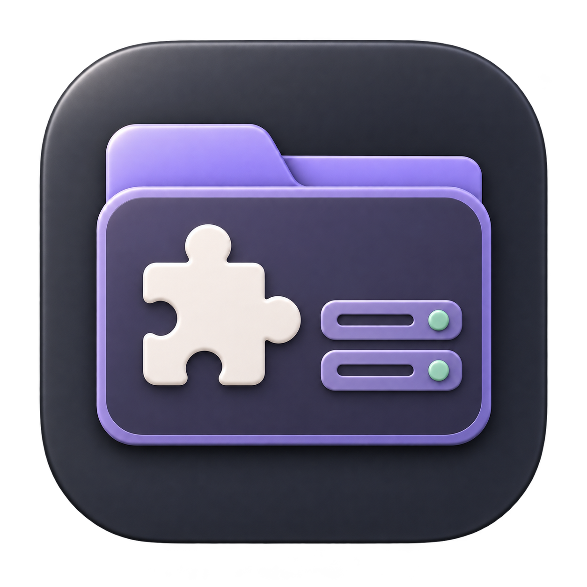

<h1 align="center">Plugins für ServerDesk</h1>

| Plugin | Version | Download |
|---|---|---|
| zRemote | 0.3.0 Alpha 10 | [Plugin herunterladen](https://github.com/ZUMBYTE-AppSolution/serverdesk-plugins/releases/download/zumbyte-remote-v0.3.0-alpha.10/ZumbyteRemote-ServerDesk-Plugin-0.3.0-alpha.10.zip) |

zRemote verbindet Computer direkt über eine feste neunstellige ID und ein Einmal- oder Dauerpasswort. Ein Konto und ein eigener Remote-Server sind dafür optional. Auf dem Zielcomputer muss [zRemote](https://github.com/ZUMBYTE-AppSolution/zumbyte-remote-release/releases) eingerichtet sein.

Für ID-Verbindungen bitte **ServerDesk Beta 28**, das **zRemote-Plugin Alpha 10** und eine aktuelle zRemote-Gegenstelle verwenden. Unter **Verbindungen → Mit zRemote-ID verbinden** stehen auch die eigene ID, das Einmalpasswort und die Zugriffseinstellungen. Eigene Remote-Server bleiben zusätzlich nutzbar.

Am Zielcomputer lässt sich jede Verbindung mit eigenen Rechten annehmen. Dauerhaft erlaubte Gegenstellen sind später änderbar. Ein kleines Fenster erlaubt während einer Freigabe das Sperren einzelner Funktionen und das Trennen der Verbindung. Auf dem Mac wird für die Freigabe dieses Computers die installierte zRemote-App benötigt.

Der Chat zeigt eigene und empfangene Nachrichten in unterschiedlichen Sprechblasen mit Uhrzeit und Zustellstatus. Links öffnen sich im Browser. Dateien werden mit Fortschritt übertragen und lassen sich gezielt speichern. Chat und Dateien gehen direkt von Computer zu Computer.

Die Steuerleiste klappt automatisch ein, lässt sich verschieben und mit der Stecknadel am Bildschirmrand fixieren. Die Auflösung des entfernten Windows-Bildschirms kann sich an Fenstergröße und Vollbild anpassen. Nach einer Unterbrechung wird die Verbindung mit einem sichtbaren Countdown erneut aufgebaut.

Wenn der entfernte Computer keinen Auflösungswechsel erlaubt, wird das vollständige Bild automatisch und ohne Verzerrung ans Fenster angepasst – auch im Vollbild. Originalgröße · 1:1 bleibt manuell auswählbar. Bild, Ton, Mauszeiger und Steuerleiste bleiben pro Computer gespeichert und lassen sich für dieses Gerät zurücksetzen. Nach 90 Minuten endet eine Sitzung.

## Installation und Updates

In ServerDesk **Einstellungen → Plugins** öffnen und zRemote installieren. Vor einem Pluginupdate laufende Remote-Tabs schließen. Zusätzliche Zugriffe auf Dateien und Zwischenablage werden beim Update angezeigt. Gespeicherte Serverprofile und Zugänge bleiben erhalten.

- [Versionsliste](https://raw.githubusercontent.com/ZUMBYTE-AppSolution/serverdesk-plugins/main/catalog.json)
- [Katalogsignatur](https://raw.githubusercontent.com/ZUMBYTE-AppSolution/serverdesk-plugins/main/catalog.sig)
- [Öffentlicher Prüfschlüssel](catalog.pub.pem)
- [Änderungen und ältere Pakete](https://github.com/ZUMBYTE-AppSolution/serverdesk-plugins/releases)

ServerDesk prüft Signatur und Prüfsumme vor der Installation. Downloads benötigen keine GitHub-Anmeldung und keine GitHub-API. Die Windows-Hilfsprogramme sind digital signiert; Herausgeber ist Andreas Zumbansen.

**Zumbyte – AppSolution · [www.zumbyte.de](https://www.zumbyte.de/)**
