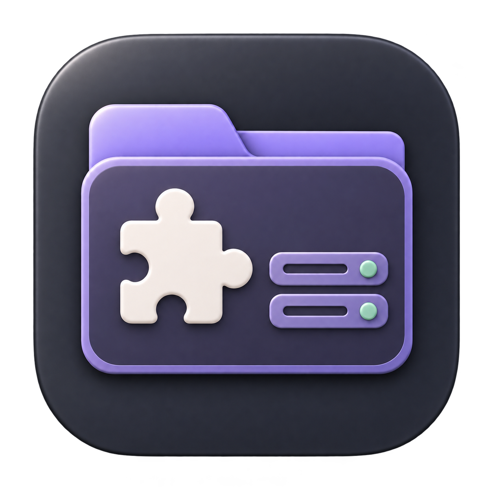

<h1 align="center">Plugins für ServerDesk</h1>

Fertige Plugin-Pakete für ServerDesk. Versionen und Änderungen findest du unter **[Releases](https://github.com/ZUMBYTE-AppSolution/serverdesk-plugins/releases)**.

| Plugin | Version | Download |
|---|---|---|
| Zumbyte Remote | 0.3.0-alpha.3 | [Plugin herunterladen](https://github.com/ZUMBYTE-AppSolution/serverdesk-plugins/releases/download/zumbyte-remote-v0.3.0-alpha.3/ZumbyteRemote-ServerDesk-Plugin-0.3.0-alpha.3.zip) |

Zumbyte Remote verbindet ServerDesk mit deinem eigenen Remote-Server. Auf dem Zielcomputer muss die [Zumbyte-Remote-App oder der Windows-Dienst](https://github.com/ZUMBYTE-AppSolution/zumbyte-remote-release/releases) eingerichtet sein. Eine kompatible ServerDesk-Version ist erforderlich. Version 0.3.0-alpha.3 behebt den Updatefehler „Unbekannte Pluginberechtigungen“ und „Die Pluginaktion konnte nicht abgeschlossen werden“ in ServerDesk Beta 24. Text-/Dateizwischenablage und erweiterte Tastaturübernahme benötigen zusätzliche Unterstützung und Freigaben durch ServerDesk.

## Installation und Updates

In ServerDesk **Einstellungen → Plugins** öffnen, den offiziellen Katalog auswählen und das gewünschte Plugin installieren. Serverprofile und gespeicherte Zugänge bleiben bei Pluginupdates erhalten.

- [Versionsliste](https://raw.githubusercontent.com/ZUMBYTE-AppSolution/serverdesk-plugins/main/catalog.json)
- [Katalogsignatur](https://raw.githubusercontent.com/ZUMBYTE-AppSolution/serverdesk-plugins/main/catalog.sig)
- [Öffentlicher Prüfschlüssel](catalog.pub.pem)
- [Alle Downloadpakete und Änderungen](https://github.com/ZUMBYTE-AppSolution/serverdesk-plugins/releases)

Katalog und Pakete werden ohne GitHub-Anmeldung geladen. Vor der Installation prüft ServerDesk Signatur und Prüfsumme.

**Zumbyte – AppSolution · [www.zumbyte.de](https://www.zumbyte.de/)**
